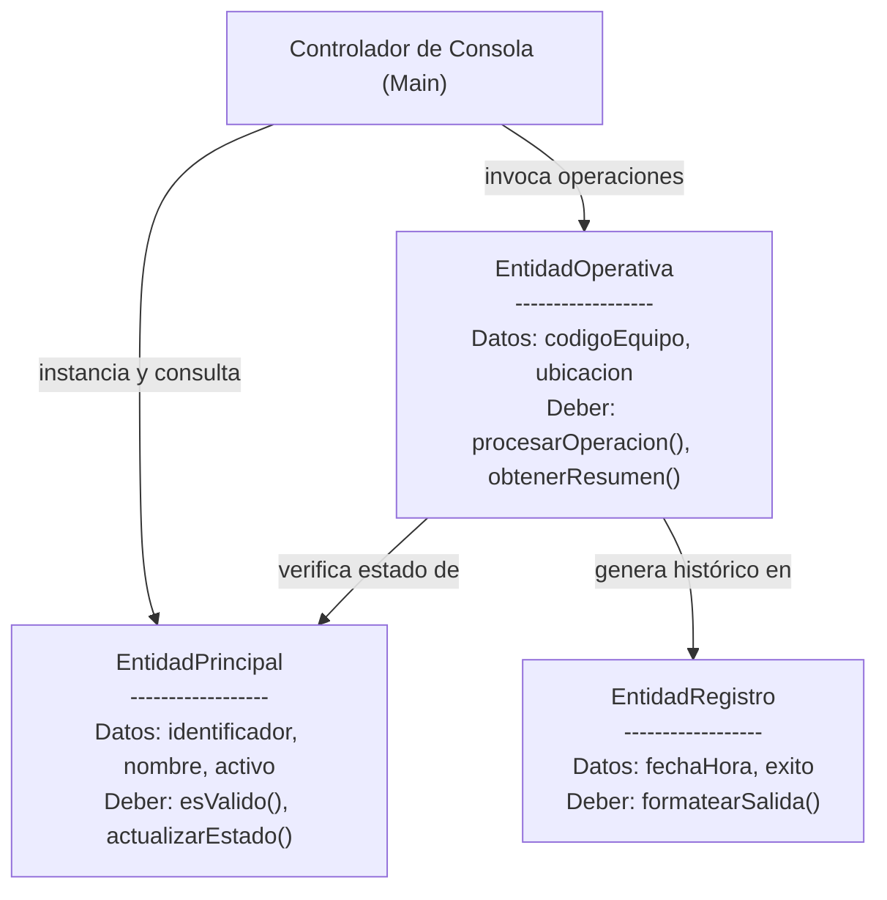
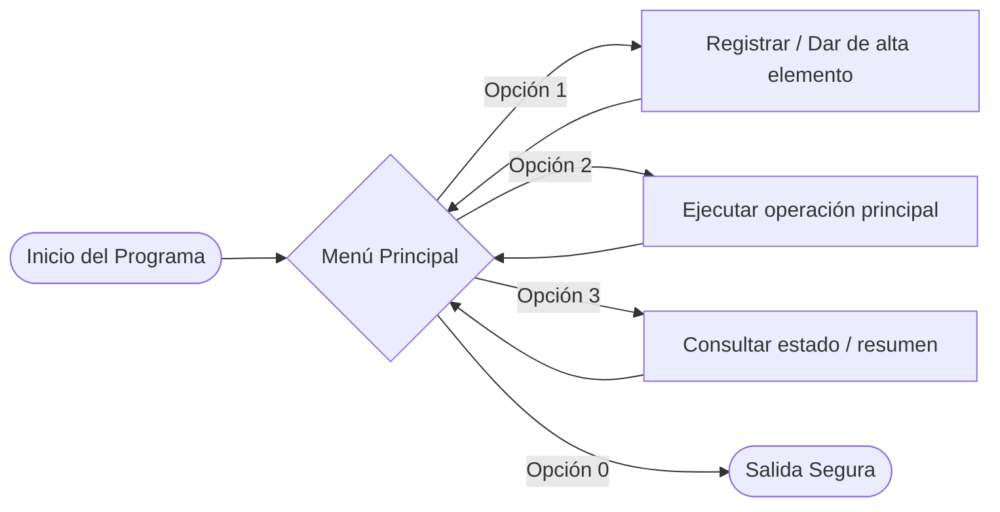

# Sprint 4. Modularización, seguimiento del proyecto y cierre de fase

---

## Semana 10. Control de seguimiento, arquitectura modular y Sprint Backlog 4

---

### Día 10 - 1 sesión

#### Teoría. Control de seguimiento y diseño de arquitectura modular

#### 1. Caso guía en AzaharTech

Es viernes 20 de noviembre de 2026 por la tarde en las instalaciones de **AzaharTech** en Castellón de la Plana. El equipo arranca oficialmente el **Sprint 4**, el último ciclo de trabajo de la fase individual con el que se cerrará el primer trimestre.

En la sala de reuniones, **Alba Torres** proyecta el código fuente del prototipo `v0.3` para el sistema de control de acceso por QR del **IES El Caminàs**. Aunque los bucles de validación y el control de excepciones funcionan adecuadamente, toda la lógica de la aplicación sigue amontonada en un único archivo monolítico (`Main.java`) donde se entremezclan la captura de datos, las reglas del centro y los informes por consola. A su lado, **Pau Ferrer** compara las fechas planificadas en el Diagrama de Gantt del sprint anterior frente al progreso real acumulado hasta la fecha.

**Laia Claramunt** toma la palabra dirigiéndose al equipo:

> *«Durante el Sprint 3 conseguisteis que el programa no se interrumpa ante datos anómalos y establecisteis una planificación temporal y de riesgos sólida. Sin embargo, cuando un archivo supera las trescientas líneas mezclando responsabilidades distintas, cualquier ajuste menor resulta arriesgado y dificulta el trabajo paralelo.*
>
> *En Programación estáis dando el salto hacia la Orientación a Objetos: vais a dividir el software en clases propias con atributos encapsulados, constructores y métodos independientes. Mientras tanto, en Entornos de Desarrollo aprenderéis a trabajar de forma segura con ramas en Git, refactorizar código en el IDE y generar documentación técnica con Javadoc.*
>
> *Antes de crear una sola clase Java, el analista debe completar dos tareas clave: en primer lugar, **auditar el seguimiento del proyecto** para verificar si existen desviaciones respecto al cronograma base; y en segundo lugar, diseñar la **Arquitectura Modular y el Diccionario de Entidades**, repartiendo claramente qué datos protege y qué funciones ejecuta cada componente. Hoy formalizaremos este plano conceptual y abriremos el **Sprint Backlog 4**»*.

---

#### 2. Fundamentos de seguimiento y diseño modular

```
┌────────────────────────────────────────────────────────────────────────────────────────┐
│                      TRANSICIÓN HACIA LA ARQUITECTURA MODULAR                          │
├──────────────────────────┬─────────────────────────────┬───────────────────────────────┤
│ 1. Control de seguimiento│ 2. Tarjetas CRC y entidades │ 3. Mapa modular del sistema   │
├──────────────────────────┼─────────────────────────────┼───────────────────────────────┤
│ Contrastar avance real   │ Definir cada componente     │ Representar gráficamente los  │
│ frente al cronograma     │ mediante sus datos propios, │ módulos independientes y las  │
│ y corregir desviaciones. │ deberes y colaboradores.    │ interacciones entre ellos.    │
└──────────────────────────┴─────────────────────────────┴───────────────────────────────┘
```

##### A. Seguimiento del proyecto y control de desviaciones

La planificación temporal elaborada en el Sprint 3 es una línea base de referencia que debe revisarse periódicamente para garantizar la viabilidad de los plazos:

* **Línea base frente a progreso real.** Consiste en comparar las fechas y horas estimadas en el Diagrama de Gantt con el trabajo efectivamente entregado al término de cada sprint.
* **Análisis de desviaciones.** Si una actividad en el camino crítico ha requerido mayor esfuerzo del estimado (*por ejemplo, al depurar incidencias imprevistas*), se calcula su impacto sobre el hito final de trimestre.
* **Acciones correctivas y control de cambios.** Ante desviaciones moderadas, se reordena la prioridad de las tareas menos críticas o se acota el alcance accesorio para garantizar la estabilidad de la entrega principal.

##### B. Descomposición modular mediante Tarjetas CRC (Clase - Responsabilidad - Colaboración)

Para pasar de un código monolítico en `Main.java` a un diseño modular ordenado sin necesidad de recurrir a notaciones formales complejas, resulta sumamente eficaz emplear la técnica ágil de las **Tarjetas CRC**:

* **Entidad o módulo (clase).** El concepto sustantivo del negocio que agrupará información y lógica propia (*por ejemplo: `UsuarioCentro`, `LectorQR`, `Fichaje`*).
* **Responsabilidades.** Qué datos encapsula (estado interno que deberá protegerse como privado) y qué operaciones sabe ejecutar de forma autónoma (*por ejemplo: validar su identificador, comprobar vigencia o formatear un registro*).
* **Colaboradores.** Con qué otras entidades necesita comunicarse para cumplir un caso de uso completo (*por ejemplo: `LectorQR` colabora con `UsuarioCentro` para validar el permiso y genera un `Fichaje`*).

Este ejercicio evita el anti-patrón *God Class* (una clase que acapara toda la lógica) y sirve como guía directa para implementar los constructores, *getters* y *setters* en Programación.

##### C. Modelado de la arquitectura modular: código declarativo y software visual

Para representar el mapa de módulos, responsabilidades y colaboraciones dentro de la memoria disponemos de dos opciones complementarias:

1. **Modelado declarativo mediante código (Mermaid en Markdown).** Mediante bloques `flowchart` integrados directamente en Markdown se dibujan los módulos del sistema, detallando sus datos/responsabilidades y las flechas de colaboración entre componentes. Esta modalidad se versiona nativamente en Git y se visualiza automáticamente en GitHub e IntelliJ IDEA.
2. **Modelado visual con software de diagramación (Draw.io Desktop).** Para quienes prefieran componer un mapa visual de módulos o tarjetas CRC con cajas de texto, iconos y colores personalizados, **Draw.io** es una herramienta libre y multiplataforma. En entornos GNU/Linux puede ejecutarse descargando su paquete portable en formato AppImage en la carpeta personal (`~/bin/` o `~/Descargas/`), asignándole permisos de ejecución con `chmod +x drawio-x86_64.AppImage` y lanzándolo directamente desde el espacio de usuario, exportando el esquema recortado como imagen PNG.

##### D. Fuentes técnicas oficiales y uso ético de la Inteligencia Artificial

* **Estándares de arquitectura y código.** El diseño modular se apoya en las guías oficiales de estilo y encapsulación de Oracle Java SE 21, las buenas prácticas de gestión ágil de la Guía Scrum y la documentación oficial de Javadoc y Git.
* **Uso ético y crítico de la IA.** La Inteligencia Artificial puede asistir proponiendo cómo repartir responsabilidades entre distintas entidades del dominio. No obstante, el analista debe depurar las propuestas para eliminar conceptos avanzados ajenos a esta fase (como herencia compleja o patrones de diseño empresariales) y documentar este filtrado en el *Prompt Log*.

---

#### Laboratorio. Arquitectura modular, seguimiento temporal y Sprint Backlog 4

Laia Claramunt presenta la hoja de ruta para la sesión práctica:

> *«Cada estudiante abrirá su repositorio para documentar el seguimiento del cronograma tras el Sprint 3 y diseñar la arquitectura modular de su proyecto de la bolsa de proyectos. Definiréis las entidades y sus tarjetas CRC, dibujaréis el mapa modular de colaboraciones y abriréis formalmente el **`sprint4-backlog.md`**»*.

---

##### Paso 1. Creación del documento de seguimiento y arquitectura modular (`pi/docs/arquitectura-modular.md`)

1. Abre tu proyecto en **IntelliJ IDEA**.
2. En la carpeta `azahartech/nombre-equipo/apellidos-nombre/pi/docs/`, crea el archivo `arquitectura-modular.md`.
3. Redacta el contenido aplicando la plantilla adaptada a **tu proyecto de la bolsa de proyectos**:

````markdown
# Seguimiento del proyecto y arquitectura modular
**Consultora:** AzaharTech Software Consulting  
**Proyecto Seleccionado:** [nombre de tu proyecto de la bolsa de proyectos]  
**Cliente / Sector:** [entidad receptora o sector profesional]  
**Desarrollador/a:** [tus apellidos, tu nombre]  
**Fecha:** 20 de noviembre de 2026  
**Versión:** 1.0 (Sprint 4)  

---

## 1. Auditoría y seguimiento del cronograma (Post-Sprint 3)

| Hito / Fase | Fecha Planificada | Estado Real (20/11/2026) | Desviación | Acción Correctiva Aplicada |
| :--- | :---: | :---: | :---: | :--- |
| **H1:** Requisitos y arquitectura base | 23/10/2026 | Completado (v0.2) | 0 días | Sin desviaciones respecto a la línea base. |
| **H2:** Planificación, lógica y pruebas | 13/11/2026 | Completado (v0.3) | 0 días | La resolución de `INC-01` consumió 1 hora adicional absorbida dentro del margen previsto. |
| **H3:** Arquitectura POO y cierre T1 | 04/12/2026 | En curso (Sprint 4) | En plazo | Priorizar la refactorización hacia clases esenciales antes de ampliar opciones de consola. |

---

## 2. Diccionario de entidades y Tarjetas CRC

Para desacoplar la lógica hasta ahora concentrada en `Main.java`, el sistema se organiza en las siguientes entidades independientes:

| Entidad (Módulo) | Datos Protegidos (Atributos privados) | Responsabilidades (Qué sabe hacer) | Colaboradores |
| :--- | :--- | :--- | :--- |
| **[EntidadPrincipal]** | `identificador`, `nombre`, `estadoActivo` | Validar el formato de sus datos en el constructor, proteger su estado mediante *getters/setters* y verificar si está operativa. | `[EntidadRegistro]` |
| **[EntidadOperativa]** | `codigoEquipo`, `ubicacion`, `contadorOperaciones` | Ejecutar el flujo principal de la operación solicitada, aplicar reglas de negocio y emitir resultados. | `[EntidadPrincipal]`, `[EntidadRegistro]` |
| **[EntidadRegistro]** | `fechaHora`, `resultado`, `observaciones` | Almacenar los datos inmutables de cada operación realizada y generar un resumen legible para la salida por consola. | Ninguno (entidad final de datos) |

---

## 3. Mapa visual de arquitectura modular

Elige una de las dos modalidades técnicas para representar los módulos y sus colaboraciones:

### Opción A: Esquema declarativo en código Mermaid



### Opción B: Esquema visual exportado desde Draw.io

Si has diseñado las tarjetas CRC o el mapa de módulos mediante **Draw.io Desktop**, guarda la imagen recortada en `pi/docs/img/arquitectura-modular.png` y referénciala aquí:

  
*Figura 1. Descomposición modular de entidades, responsabilidades y flujo de colaboración.*

---

## 4. Fuentes técnicas y estándares de referencia
* **Oracle Java SE 21 Documentation:** Guía oficial sobre definición de clases, encapsulamiento y modificadores de acceso.
* **Javadoc Tool Guide (Oracle):** Estándar de comentarios y etiquetas (`@param`, `@return`) para documentación técnica de código fuente.
* **ISO/IEC/IEEE 12207:** Procesos de seguimiento, control de cambios y trazabilidad en proyectos de software.

---

## 5. Registro ético de uso de Inteligencia Artificial (Prompt Log)

| Fecha | Herramienta | Objetivo de la consulta | Prompt introducido | Revisión crítica y ajuste aplicado |
| :---: | :---: | :--- | :--- | :--- |
| 20/11/2026 | ChatGPT / Claude | Repartir responsabilidades al modularizar `Main` | *"Tengo una aplicación Java en consola sobre [tu dominio] en un solo archivo. Sugiere 3 entidades usando tarjetas CRC para separar responsabilidades..."* | Se descartaron sugerencias de interfaces o clases abstractas propuestas por la IA, manteniendo exclusivamente entidades concretas con encapsulación básica acorde al Sprint 4. |
````

---

##### Paso 2. Creación del Sprint Backlog 4 (`pi/backlog/sprint4-backlog.md`)

1. En la carpeta `azahartech/nombre-equipo/apellidos-nombre/pi/backlog/`, crea el archivo `sprint4-backlog.md`.
2. Registra los compromisos de trabajo del **Sprint 4** coordinando los tres módulos:

```markdown
# Sprint Backlog 4 — [nombre de tu proyecto]
**Periodo:** 16 de noviembre – 4 de diciembre de 2026  
**Responsable:** [tu nombre]  

## Objetivo general del Sprint 4
Construir el incremento v0.4 (cierre de la fase individual): formalizar el seguimiento temporal y la arquitectura modular en Proyecto Intermodular; dominar el uso de ramas en Git, refactorización y Javadoc en Entornos de Desarrollo; y modularizar la aplicación en clases propias con constructores y encapsulación en Programación.

---

## Tareas

### Módulo: Proyecto Intermodular (PI)
- [ ] T-PI-14: Auditar el seguimiento del cronograma y diseñar la arquitectura modular con Tarjetas CRC (`pi/docs/arquitectura-modular.md` o `pi/docs/img/arquitectura-modular.png`)
- [ ] T-PI-15: Registrar el uso ético de IA (*Prompt Log*) en la descomposición modular
- [ ] T-PI-16: Redactar la guía técnica y manual de usuario del prototipo junto con la auditoría de calidad (Semana 11)
- [ ] T-PI-17: Consolidar el Capítulo 4 en `memoria.md`, preparar la demo v0.4 y cerrar el Primer Trimestre (Semana 12)

### Módulo: Entornos de Desarrollo (ED)
- [ ] T-ED-11: Gestionar el desarrollo modular creando ramas independientes en Git (`feature/...`) y fusionarlas mediante *merge*
- [ ] T-ED-12: Aplicar herramientas de refactorización asistida en IntelliJ IDEA (renombrado seguro y extracción de código)
- [ ] T-ED-13: Documentar las clases y métodos con etiquetas estándar Javadoc y generar los archivos HTML de documentación técnica

### Módulo: Programación (PR)
- [ ] T-PR-10: Crear las clases propias definidas en las tarjetas CRC separando la lógica de negocio de `Main`
- [ ] T-PR-11: Declarar atributos privados (`private`) e implementar constructores, *getters* y *setters* con validación interna
- [ ] T-PR-12: Instanciar objetos en memoria, gestionar el paso de parámetros entre clases y verificar su operativa en consola
```

---

##### Paso 3. Confirmación y sincronización en GitHub

1. En IntelliJ IDEA, abre la ventana de confirmación mediante el atajo `Ctrl + K`.
2. Comprueba que están seleccionados los archivos creados en la sesión:
    * `pi/docs/arquitectura-modular.md`
    * `pi/backlog/sprint4-backlog.md`
    * *(Opcional)* `pi/docs/img/arquitectura-modular.png` si has optado por diseñar el esquema visual con Draw.io Desktop.
3. Escribe el mensaje de confirmación aplicando el formato estándar **Conventional Commits**:

```text
docs(pi): definir seguimiento temporal, arquitectura modular y abrir sprint backlog 4
```

4. Ejecuta la operación mediante **Commit and Push**.
5. Accede a tu repositorio remoto en GitHub desde el navegador y comprueba que los documentos aparecen correctamente estructurados y que el mapa de arquitectura modular se visualiza con total nitidez.

---

## Semana 11. Manual de usuario, guía técnica y auditoría de calidad

---

### Día 11 - 1 sesión

#### Teoría. Documentación de usuario, operación técnica y aseguramiento de la calidad

#### 1. Caso guía en AzaharTech

Es viernes 27 de noviembre de 2026 por la tarde en la sede de **AzaharTech** en Castellón de la Plana. Durante la última semana, el equipo ha refactorizado el proyecto dividiendo la lógica en clases independientes con atributos privados y constructores en Programación, mientras que en Entornos de Desarrollo ha trabajado sobre ramas `feature` en Git y ha comenzado a documentar métodos con etiquetas Javadoc.

En la sala de pruebas, **Pau Ferrer** intenta mostrar el funcionamiento del prototipo modularizado a una persona del equipo de conserjería del **IES El Caminàs** invitado a revisar los avances. Sin embargo, el usuario externo no sabe cómo arrancar la aplicación desde la terminal ni qué opciones introducir ante el menú inicial. Al mismo tiempo, **Alba Torres** detecta que dos requisitos secundarios definidos en octubre todavía no se han comprobado frente a las nuevas clases creadas.

**Laia Claramunt** interviene para centrar la sesión de trabajo:

> *«Un software perfectamente encapsulado en Java y documentado con Javadoc es excelente para otros programadores, pero resulta inútil si el cliente final no sabe operarlo o si nadie ha comprobado que cumple todos los requisitos comprometidos al principio del trimestre.*
>
> *En la ingeniería profesional distinguimos con claridad dos tipos de documentación de producto: el **Manual de Usuario Final**, redactado en un lenguaje claro, libre de jerga de programación y guiado paso a paso para quien usa la aplicación; y la **Guía Técnica de Despliegue y Mantenimiento**, dirigida al equipo técnico que deberá compilar, actualizar o integrar el sistema en el futuro.*
>
> *Hoy redactaremos ambos documentos para vuestro proyecto, realizaremos una **Auditoría de Calidad y Trazabilidad** contrastando las clases actuales contra vuestros requisitos del Sprint 2, y actualizaremos el **Sprint Backlog 4** dejando todo listo para el cierre del trimestre la próxima semana»*.

---

#### 2. Fundamentos de documentación de producto y auditoría de calidad

```
┌────────────────────────────────────────────────────────────────────────────────────────┐
│                      CALIDAD Y DOCUMENTACIÓN DE PRODUCTO                               │
├──────────────────────────┬─────────────────────────────┬───────────────────────────────┤
│ 1. Manual de Usuario     │ 2. Guía Técnica             │ 3. Auditoría de Calidad       │
├──────────────────────────┼─────────────────────────────┼───────────────────────────────┤
│ Cómo ejecutar y operar   │ Requisitos de entorno,      │ Matriz de trazabilidad que    │
│ los menús paso a paso    │ estructura de paquetes,     │ verifica cada RF y RNF frente │
│ sin conocimientos Java.  │ compilación y Javadoc.      │ a las pruebas realizadas.     │
└──────────────────────────┴─────────────────────────────┴───────────────────────────────┘
```

##### A. El Manual de Usuario Final (orientado a la operativa)

El manual de usuario tiene como único destinatario a la persona que utilizará la herramienta en su jornada laboral diaria:

* **Lenguaje claro y orientado a tareas.** Debe evitar referencias internas a clases, variables o excepciones Java. En su lugar, describe qué opción pulsar y qué resultado aparecerá en pantalla.
* **Mapa de navegación y menús.** Representación esquemática del flujo de pantallas u opciones de consola disponibles desde el arranque hasta la salida segura.
* **Gestión de errores comprensible.** Tabla breve de problemas cotidianos (*por ejemplo: qué ocurre si se introduce un dato incorrecto o vacío*) y qué indica el mensaje de advertencia en pantalla para corregirlo.

##### B. La Guía Técnica de Mantenimiento y Despliegue (orientada al desarrollador)

A diferencia del manual de usuario, la guía técnica permite a otro técnico o compañero incorporar cambios en el código con rapidez:

* **Requisitos previos de ejecución y compilación.** Versión exacta del entorno Java (`OpenJDK 21 LTS`), herramienta de construcción (`Apache Maven`) y comandos exactos para compilar y ejecutar desde la raíz del proyecto.
* **Estructura modular de paquetes y Javadoc.** Descripción de la organización de carpetas, localización de las clases propias creadas en Programación y ruta hacia la documentación HTML generada mediante Javadoc en Entornos de Desarrollo.
* **Flujo de trabajo en el repositorio.** Convención de ramas empleada (`main`, `feature/...`) y reglas de confirmación para futuras ampliaciones.

##### C. Auditoría de calidad y matriz de trazabilidad

Antes de dar por válida una versión entregable al cliente, el gestor de proyectos ejecuta una **auditoría de trazabilidad**:

* Consiste en cruzar la lista de **Requisitos Funcionales (RF)** y **Requisitos No Funcionales (RNF)** redactados en el Sprint 2 frente al estado actual del software refactorizado.
* Para cada requisito se verifica si está **Implementado y Verificado**, **En progreso** o **Pendiente para sprints posteriores**, dejando constancia objetiva de la evidencia que respalda su cumplimiento (por ejemplo, ejecución superada o clase responsable).

##### D. Representación del flujo de interacción: código declarativo y software visual

Para ilustrar los pasos de navegación del usuario dentro del manual podemos elegir entre dos enfoques:

1. **Diagrama de flujo de menús en código declarativo (Mermaid en Markdown).** Permite describir el árbol de navegación del menú de consola mediante bloques `flowchart LR` integrados directamente en Markdown, junto con bloques de ejemplo de sesión en terminal. Es fácilmente editable y se visualiza nativamente en GitHub.
2. **Esquemas o capturas anotadas con software libre visual (Flameshot / Draw.io Desktop).** Si se opta por incorporar apoyo gráfico visual, en entornos GNU/Linux pueden utilizarse herramientas libres ejecutables desde la carpeta personal del usuario en formato portable AppImage (`chmod +x` sobre el paquete descargado): **Flameshot** permite capturar la consola en ejecución y añadir flechas, recuadros y pasos numerados; mientras que **Draw.io Desktop** permite maquetar el diagrama de menús de usuario y exportarlo como imagen PNG optimizada en `pi/docs/img/`.

##### E. Sinergia directa con Programación y Entornos de Desarrollo

* En **Programación**, los menús interactivos y las clases encapsuladas (`private`, constructores, *getters*/*setters*) son el objeto directo de descripción tanto en el manual operativo como en la trazabilidad de requisitos.
* En **Entornos de Desarrollo**, la generación automática de documentación **Javadoc** y la organización mediante ramas `feature` en Git constituyen la base técnica de la guía de mantenimiento.

---

#### Laboratorio. Manual de usuario, guía técnica y auditoría del prototipo

Laia Claramunt detalla las instrucciones para el trabajo práctico de hoy:

> *«Vais a crear en vuestro repositorio el documento unificado de manual de usuario, guía técnica y auditoría de calidad de vuestro proyecto de la bolsa de proyectos. Comprobaréis si los requisitos que prometisteis en el Sprint 2 se cumplen en vuestras nuevas clases Java, documentaréis cómo se utiliza la aplicación en consola y actualizaréis el **`sprint4-backlog.md`** con las tareas superadas esta semana»*.

---

##### Paso 1. Creación del documento de manual, guía técnica y auditoría (`pi/docs/manual-usuario-calidad.md`)

1. Abre tu proyecto en **IntelliJ IDEA**.
2. En la carpeta `azahartech/nombre-equipo/apellidos-nombre/pi/docs/`, crea el archivo `manual-usuario-calidad.md`.
3. Redacta el contenido adaptando la siguiente plantilla técnica a **tu proyecto de la bolsa de proyectos**:

````markdown
# Manual de usuario, guía técnica y auditoría de calidad
**Consultora:** AzaharTech Software Consulting  
**Proyecto Seleccionado:** [nombre de tu proyecto de la bolsa de proyectos]  
**Cliente / Sector:** [entidad receptora o sector profesional]  
**Desarrollador/a:** [tus apellidos, tu nombre]  
**Fecha:** 27 de noviembre de 2026  
**Versión:** 1.0 (Sprint 4)  

---

## 1. Manual de Usuario Final

### 1.1. Arranque de la aplicación
Para iniciar la herramienta en el puesto de trabajo:
1. Abre la terminal del sistema operativo y sitúate en la carpeta del proyecto.
2. Ejecuta la aplicación mediante el lanzador configurado en el entorno de trabajo.
3. En pantalla aparecerá el saludo de bienvenida y el menú principal numerado.

### 1.2. Mapa de navegación y opciones disponibles

Elige una de las dos modalidades técnicas para ilustrar el flujo de interacción del usuario:

#### Opción A: Flujo de menú declarativo en código Mermaid



#### Opción B: Captura anotada o esquema visual de escritorio

Si has capturado y anotado la ejecución en consola con **Flameshot** o maquetado el flujo de pantallas con **Draw.io Desktop**, guarda la imagen recortada en `pi/docs/img/flujo-usuario.png` y vincúlala aquí:

  
*Figura 1. Guía visual paso a paso de interacción con el menú principal en consola.*

### 1.3. Ejemplo de sesión operativa en consola
```text
=========================================
   SISTEMA DE GESTIÓN — [TU PROYECTO]
=========================================
1. Registrar nuevo elemento
2. Procesar operación
3. Mostrar resumen de actividad
0. Salir
Seleccione una opción: 2
> Introduzca el código identificativo: ID-104
[OK] Operación registrada correctamente.
```

### 1.4. Preguntas frecuentes y mensajes de aviso al usuario
* **"Formato de entrada no válido. Introduzca un número entero":** Has escrito letras o símbolos en una casilla numérica. Vuelve a teclear el número solicitado; el programa no perderá los datos previos.
* **"El campo no puede estar vacío":** Pulsaste *Enter* sin escribir el código requerido. Escribe el identificador completo y confirma.

---

## 2. Guía Técnica de Despliegue y Mantenimiento

### 2.1. Requisitos de entorno y compilación
* **Entorno de ejecución:** Java Development Kit **OpenJDK 21 LTS** o superior.
* **Gestor de proyecto y compilación:** **Apache Maven** (`pom.xml` en raíz).
* **Comandos de compilación y empaquetado local:**
  ```bash
  mvn clean compile
  mvn exec:java
  ```

### 2.2. Estructura de paquetes y documentación Javadoc
* `src/main/java/`: Contiene la clase controladora `Main.java` y las clases de dominio encapsuladas diseñadas en el Sprint 4 (`[EntidadPrincipal]`, `[EntidadOperativa]`, `[EntidadRegistro]`).
* `target/site/apidocs/`: Directorio donde se genera la documentación HTML técnica automática mediante **Javadoc** (ejecutable en IntelliJ IDEA mediante *Tools $\rightarrow$ Generate JavaDoc...*).

### 2.3. Flujo de ramas en Git
* `main`: Rama estable que contiene únicamente versiones consolidadas y etiquetadas (`v0.1`, `v0.2`, `v0.3`).
* `feature/*`: Ramas de trabajo temporal empleadas para implementar y refactorizar cada clase antes de su integración mediante *merge*.

---

## 3. Auditoría de calidad y matriz de trazabilidad (Sprint 2 $\rightarrow$ Sprint 4)

| Código | Requisito Comprometido | Clase / Componente Responsable | Estado Actual (27/11/2026) | Evidencia de Verificación |
| :---: | :--- | :--- | :---: | :--- |
| **RF-01** | Captura y validación de entradas principales del usuario | `Main` + `[EntidadPrincipal]` | Cumplido | Pruebas manuales con bucles y control de excepciones superadas |
| **RF-02** | Procesamiento de regla de negocio central | `[EntidadOperativa]` | Cumplido | Método operativo ejecutado y verificado tras refactorización POO |
| **RF-03** | Generación de resumen o salida estructurada | `[EntidadRegistro]` | Cumplido | Formato de salida verificado en consola |
| **RF-04** | Persistencia avanzada en ficheros externos | *(Planificado para Fase 2)* | Pendiente | Programado en el cronograma para el Sprint 5/6 |
| **RNF-01** | Ejecución en OpenJDK 21 LTS y estructura Maven | `pom.xml` | Cumplido | Compilación limpia mediante `mvn clean compile` |
| **RNF-02** | Documentación viva en Markdown y Javadoc técnico | `pi/docs/` y Javadoc HTML | Cumplido | Enlaces relativos y etiquetas `@param`/`@return` validados |

---

## 4. Registro ético de uso de Inteligencia Artificial (Prompt Log)

| Fecha | Herramienta | Objetivo de la consulta | Prompt introducido | Revisión crítica y ajuste aplicado |
| :---: | :---: | :--- | :--- | :--- |
| 27/11/2026 | ChatGPT / Claude | Revisar claridad del manual para usuarios no técnicos | *"Revisa estas instrucciones de uso de una aplicación en consola para asegurar que un usuario sin conocimientos informáticos las entiende sin ambigüedades..."* | Se eliminó todo término técnico referido a *excepciones*, *objetos* o *JVM* de la sección 1, trasladando esos detalles exclusivamente a la sección 2 (Guía Técnica). |
````

---

##### Paso 2. Actualización del Sprint Backlog 4 (`pi/backlog/sprint4-backlog.md`)

1. Abre el archivo `pi/backlog/sprint4-backlog.md`.
2. Actualiza el progreso de las tareas correspondientes a la **Semana 11**, marcando con `[x]` las actividades completadas:

```markdown
# Sprint Backlog 4 — [nombre de tu proyecto]
**Periodo:** 16 de noviembre – 4 de diciembre de 2026  
**Responsable:** [tu nombre]  

## Objetivo general del Sprint 4
Construir el incremento v0.4 (cierre de la fase individual): formalizar el seguimiento temporal y la arquitectura modular en Proyecto Intermodular; dominar el uso de ramas en Git, refactorización y Javadoc en Entornos de Desarrollo; y modularizar la aplicación en clases propias con constructores y encapsulación en Programación.

---

## Tareas

### Módulo: Proyecto Intermodular (PI)
- [x] T-PI-14: Auditar el seguimiento del cronograma y diseñar la arquitectura modular con Tarjetas CRC (`pi/docs/arquitectura-modular.md` o `pi/docs/img/arquitectura-modular.png`)
- [x] T-PI-15: Registrar el uso ético de IA (*Prompt Log*) en la descomposición modular
- [x] T-PI-16: Redactar la guía técnica y manual de usuario del prototipo junto con la auditoría de calidad (`pi/docs/manual-usuario-calidad.md`)
- [ ] T-PI-17: Consolidar el Capítulo 4 en `memoria.md`, preparar la demo v0.4 y cerrar el Primer Trimestre (Semana 12)

### Módulo: Entornos de Desarrollo (ED)
- [x] T-ED-11: Gestionar el desarrollo modular creando ramas independientes en Git (`feature/...`) y fusionarlas mediante *merge*
- [x] T-ED-12: Aplicar herramientas de refactorización asistida en IntelliJ IDEA (renombrado seguro y extracción de código)
- [x] T-ED-13: Documentar las clases y métodos con etiquetas estándar Javadoc y generar los archivos HTML de documentación técnica

### Módulo: Programación (PR)
- [x] T-PR-10: Crear las clases propias definidas en las tarjetas CRC separando la lógica de negocio de `Main`
- [x] T-PR-11: Declarar atributos privados (`private`) e implementar constructores, *getters* y *setters* con validación interna
- [x] T-PR-12: Instanciar objetos en memoria, gestionar el paso de parámetros entre clases y verificar su operativa en consola
```

---

##### Paso 3. Confirmación y sincronización en GitHub

1. En IntelliJ IDEA, abre la ventana de confirmación mediante el atajo `Ctrl + K`.
2. Comprueba que están seleccionados los archivos modificados y creados durante la sesión:
    * `pi/docs/manual-usuario-calidad.md`
    * `pi/backlog/sprint4-backlog.md`
    * *(Opcional)* `pi/docs/img/flujo-usuario.png` si has utilizado Flameshot o Draw.io Desktop para generar apoyo gráfico visual.
3. Escribe el mensaje de confirmación aplicando el formato estándar **Conventional Commits**:

```text
docs(pi): redactar manual de usuario, guia tecnica y auditoria de calidad
```

4. Pulsa sobre **Commit and Push**.
5. Accede a tu repositorio remoto en GitHub desde el navegador y comprueba que el manual de usuario, la guía técnica y la matriz de trazabilidad se visualizan correctamente junto con el progreso actualizado del backlog.

---

## Semana 12. Consolidación de la memoria técnica y demo del incremento v0.4

---

### Día 12 - 1 sesión

#### Teoría. Consolidación del Dossier de Fase Individual, auditoría final y defensa técnica

#### 1. Caso guía en AzaharTech

Es viernes 4 de diciembre de 2026 por la tarde en la sede de **AzaharTech** en Castellón de la Plana. El calendario marca la última jornada del **Sprint 4** y, con él, la conclusión de la **Fase Individual** del proyecto correspondiente al primer trimestre del curso.

En la sala de presentaciones, **Alba Torres** muestra en pantalla la nueva estructura del proyecto del **IES El Caminàs**: el antiguo código concentrado en `Main.java` ha quedado limpio, orquestando únicamente la interacción principal por consola mientras delega toda la lógica de negocio en las clases encapsuladas `UsuarioCentro`, `LectorQR` y `RegistroAcceso`. A su lado, **Pau Ferrer** navega por el navegador web mostrando la documentación HTML autogenerada con Javadoc y el historial de ramas `feature` correctamente fusionadas en `main`.

**Laia Claramunt** toma la palabra ante el equipo:

> *«Hoy no cerramos un sprint cualquiera: completamos el primer gran hito del curso. En apenas doce semanas habéis pasado de analizar una necesidad real en bruto a entregar una aplicación Java modular, compilable bajo Maven, libre de caídas ante entradas anómalas, documentada con Javadoc y respaldada por una memoria técnica profesional.*
>
> *Al igual que hicisteis en los cierres anteriores, todo el trabajo técnico y de gestión realizado durante las semanas 10 y 11 debe unificarse en nuestro documento maestro **`memoria.md`** como **Capítulo 4**. Esto cerrará la primera parte del dossier técnico de vuestro proyecto individual, dejándolo preparado para escalar hacia desarrollos de mayor envergadura en el segundo trimestre.*
>
> *Hoy consolidaremos ese Capítulo 4, redactaremos el guion cronometrado de 3 minutos para defender el incremento **`v0.4`**, cerraremos al 100 % el **Sprint Backlog 4** y sellaremos visualmente el repositorio en IntelliJ IDEA con la etiqueta **`v0.4`**»*.

---

#### 2. Fundamentos de cierre de fase y defensa de producto

```
┌────────────────────────────────────────────────────────────────────────────────────────┐
│                    CIERRE DEL PRIMER TRIMESTRE (INCREMENTO v0.4)                       │
├──────────────────────────┬─────────────────────────────┬───────────────────────────────┤
│ 1. Consolidación Cap. 4  │ 2. Cierre de Backlog        │ 3. Sprint Review (3 minutos)  │
├──────────────────────────┼─────────────────────────────┼───────────────────────────────┤
│ Integrar seguimiento,    │ Validar la auditoría final  │ Defender la transición a POO, │
│ tarjetas CRC, manuales   │ de trazabilidad (RF/RNF) y  │ la calidad documental y el    │
│ y auditoría en memoria.md│ marcar el 100 % de éxito.   │ prototipo modular en consola. │
└──────────────────────────┴─────────────────────────────┴───────────────────────────────┘
```

##### A. Estructura del Capítulo 4 en la memoria técnica

Con la incorporación del cuarto capítulo, la memoria técnica del proyecto alcanza una cobertura integral de todo el ciclo de ingeniería ejecutado hasta el momento:

* **Capítulo 1 (Sprint 1):** Análisis de necesidades, ODS y estudio de viabilidad técnica.
* **Capítulo 2 (Sprint 2):** Catálogo formal de requisitos (RF/RNF), arquitectura funcional IPO y previsión de recursos.
* **Capítulo 3 (Sprint 3):** Planificación temporal (EDT y Gantt), matriz cuantitativa de riesgos, planes de contingencia y protocolo de incidencias.
* **Capítulo 4 (Sprint 4):** Seguimiento de desviaciones del cronograma, descomposición modular (Tarjetas CRC), manual de usuario final, guía técnica de mantenimiento y auditoría final de trazabilidad.

##### B. Cierre formal de la Fase Individual y preparación de la siguiente etapa

Al terminar el Sprint 4, el prototipo individual debe cumplir estrictamente la *Definition of Done* (DoD) de fin de trimestre:
* Código Java refactorizado en clases propias con atributos `private`, constructores, *getters* y *setters*, sin advertencias de compilación en Maven.
* Ramas `feature` integradas limpiamente en la rama principal `main` sin conflictos pendientes.
* Documentación Javadoc generada y actualizada junto con los cuatro capítulos consolidados en `pi/docs/memoria.md`.
* Auditoría de trazabilidad completada dejando constancia objetiva de qué requisitos están cumplidos y cuáles quedan planificados para la siguiente fase del curso.

##### C. Estructura de la demostración técnica en 3 minutos (*The 3-Minute Demo v0.4*)

La defensa oral del incremento `v0.4` cierra el trimestre ante el cliente o tribunal evaluador demostrando madurez técnica y capacidad de síntesis:

* **Minuto 1: Seguimiento del proyecto y arquitectura modular.** Mostrar la evolución del proyecto desde el Sprint 1 hasta hoy, confirmando el cumplimiento de hitos en el cronograma y presentando el reparto de responsabilidades mediante las Tarjetas CRC o el mapa modular.
* **Minuto 2: Demostración en vivo y calidad del código.** Ejecutar la aplicación modular desde IntelliJ IDEA mostrando su operativa fluida en consola, enseñar brevemente el paso de `Main` a las clases encapsuladas y exhibir la documentación Javadoc o el Manual de Usuario.
* **Minuto 3: Auditoría de requisitos y visión de futuro.** Repasar la matriz de trazabilidad (qué requisitos funcionales y no funcionales ya están verificados) y proyectar el salto hacia el próximo trimestre (estructuras de almacenamiento en memoria, persistencia en ficheros y trabajo colaborativo en equipo).

##### D. Soporte visual para la exposición: código declarativo y herramientas de escritorio

Para acompañar la defensa oral con un guion visual sintético de tres o cuatro diapositivas se dispone de dos opciones de trabajo:

1. **Presentaciones declarativas basadas en código (Marp en Markdown).** Permite definir las diapositivas directamente en un archivo Markdown utilizando separadores `---`, integrando diagramas Mermaid y bloques de código sin salir del repositorio de Git.
2. **Presentaciones mediante software visual de escritorio (LibreOffice Impress).** Aplicación libre para diseñar diapositivas con apoyo gráfico y capturas anotadas de consola. En entornos GNU/Linux puede ejecutarse mediante su paquete portable en formato AppImage descargado en la carpeta personal (`~/bin/` o `~/Descargas/`), asignándole permisos de ejecución y lanzándolo directamente desde el espacio de usuario, exportando la presentación final en formato PDF.

##### E. Sellado visual de la entrega mediante etiquetado semántico (`v0.4`)

El cierre de la Fase Individual se sella formalmente creando la etiqueta anotada **`v0.4`** directamente desde la interfaz gráfica de IntelliJ IDEA y activando la casilla **Push Tags** al sincronizar con GitHub.

---

#### Laboratorio. Consolidación del Capítulo 4, cierre del Sprint 4 y demo v0.4

Laia Claramunt imparte las directrices finales del trimestre:

> *«Cerramos hoy la primera etapa del proyecto. Abrid vuestro archivo maestro **`memoria.md`**, incorporad el **Capítulo 4** unificando el seguimiento, la arquitectura modular, el manual de usuario, la guía técnica y la auditoría de trazabilidad; redactad el guion de la defensa **`guion-demo-v04.md`**; cerrad al 100 % el **`sprint4-backlog.md`** y publicad la etiqueta **`v0.4`** desde IntelliJ IDEA»*.

---

##### Paso 1. Consolidación de la memoria técnica (`pi/docs/memoria.md`)

1. Abre tu proyecto en **IntelliJ IDEA**.
2. Abre el documento maestro `azahartech/nombre-equipo/apellidos-nombre/pi/docs/memoria.md`.
3. Al final del documento (a continuación del Capítulo 3), añade el **Capítulo 4**, integrando y resumiendo de forma coherente los contenidos de `arquitectura-modular.md` y `manual-usuario-calidad.md` adaptados a **tu proyecto de la bolsa de proyectos**:

````markdown

---

# Capítulo 4: Arquitectura modular, calidad documental y cierre de fase

## 4.1. Auditoría de seguimiento temporal (Fin del Trimestre 1)
Tras completar los cuatro sprints de la fase individual, el proyecto mantiene la alineación con el cronograma base aprobado:

| Hito / Fase | Fecha Planificada | Estado Final (04/12/2026) | Desviación | Balance de Ejecución |
| :--- | :---: | :---: | :---: | :--- |
| **H1:** Requisitos y arquitectura base | 23/10/2026 | Completado (`v0.2`) | 0 días | Catálogo RF/RNF y diagrama IPO validados en plazo. |
| **H2:** Planificación, lógica y pruebas | 13/11/2026 | Completado (`v0.3`) | 0 días | Incidencia `INC-01` resuelta sin impacto en la fecha final. |
| **H3:** Arquitectura POO y cierre T1 | 04/12/2026 | Completado (`v0.4`) | 0 días | Código refactorizado en clases propias y documentación consolidada. |

---

## 4.2. Arquitectura modular y Tarjetas CRC
Para superar el diseño monolítico inicial, la lógica de la aplicación se ha distribuido en entidades independientes con encapsulación de atributos (`private`), constructores y métodos propios:

| Entidad (Clase) | Datos Protegidos | Responsabilidades Clave | Colaboradores |
| :--- | :--- | :--- | :--- |
| **[EntidadPrincipal]** | `identificador`, `nombre`, `estadoActivo` | Validar formato de alta, proteger su estado mediante *getters/setters* y verificar operatividad. | `[EntidadRegistro]` |
| **[EntidadOperativa]** | `codigoEquipo`, `ubicacion`, `contadorOperaciones` | Ejecutar el núcleo operativo, aplicar reglas de negocio y emitir resultados. | `[EntidadPrincipal]`, `[EntidadRegistro]` |
| **[EntidadRegistro]** | `fechaHora`, `resultado`, `observaciones` | Registrar de forma estructurada cada transacción realizada y generar resumen legible. | Ninguno |

*(Incluye aquí el esquema Mermaid de arquitectura modular o la referencia a la imagen `img/arquitectura-modular.png` generada con Draw.io Desktop).*

---

## 4.3. Síntesis de documentación de producto (Usuario y Técnica)

### Operación para el usuario final
El sistema ofrece un menú numérico interactivo en consola con validación guiada de entradas y mensajes de error claros sin tecnicismos.

*(Incluye aquí el flujo de menús en Mermaid o la referencia a la captura anotada `img/flujo-usuario.png` realizada con Flameshot o Draw.io Desktop).*

### Despliegue técnico y mantenimiento
* **Entorno:** OpenJDK 21 LTS y construcción automatizada mediante Apache Maven (`mvn clean compile`).
* **Documentación de código:** Generada mediante etiquetas estándar **Javadoc** en `target/site/apidocs/`.
* **Control de versiones:** Desarrollo modular sobre ramas `feature/*` integradas en `main` con mensajes *Conventional Commits*.

---

## 4.4. Auditoría final de trazabilidad (Requisitos vs. Prototipo v0.4)

| Código | Requisito Comprometido | Componente Responsable | Estado (04/12/2026) | Evidencia de Verificación |
| :---: | :--- | :--- | :---: | :--- |
| **RF-01** | Captura y validación de entradas principales | `Main` + `[EntidadPrincipal]` | Cumplido | Pruebas manuales con bucles y control de excepciones superadas |
| **RF-02** | Procesamiento de la regla de negocio central | `[EntidadOperativa]` | Cumplido | Ejecución validada tras refactorización orientada a objetos |
| **RF-03** | Emisión de resúmenes o informes por consola | `[EntidadRegistro]` | Cumplido | Salida estructurada comprobada en sesión operativa |
| **RF-04** | Persistencia avanzada en ficheros externos | *(Planificado Fase 2)* | Pendiente | Programado para el segundo trimestre (Sprints 5-6) |
| **RNF-01** | Compatibilidad OpenJDK 21 y estructura Maven | `pom.xml` | Cumplido | Compilación limpia verificada sin dependencias externas |
| **RNF-02** | Documentación viva Markdown y Javadoc | `pi/docs/` + Javadoc | Cumplido | Memoria consolidada (Cap. 1–4) y Javadoc HTML generados |

---

## 4.5. Registro acumulativo de Inteligencia Artificial (Prompt Log)

| Fecha | Herramienta | Objetivo | Prompt resumido | Ajuste crítico aplicado |
| :---: | :---: | :--- | :--- | :--- |
| 04/12/2026 | ChatGPT / Claude | Revisar coherencia entre capítulos de la memoria | *"Revisa la transición entre los requisitos del Sprint 2 y la auditoría de trazabilidad del Sprint 4 para detectar incoherencias de alcance..."* | Se ajustaron los estados de los requisitos de persistencia como *Pendientes para Fase 2* para reflejar con honestidad el alcance real del incremento `v0.4`. |
````

---

##### Paso 2. Redacción del guion de la demostración oral (`pi/docs/guion-demo-v04.md`)

1. En la carpeta `azahartech/nombre-equipo/apellidos-nombre/pi/docs/`, crea el archivo `guion-demo-v04.md`.
2. Completa la ficha de exposición cronometrada en **3 minutos**:

```markdown
# Guion de la Sprint Review — Incremento v0.4 (Cierre Fase Individual)
**Proyecto:** [nombre de tu proyecto]  
**Ponente:** [tu nombre]  
**Duración límite:** 180 segundos (3 minutos)  
**Fecha de defensa:** 4 de diciembre de 2026  

---

## Minuto 1: Balance de seguimiento y arquitectura modular (00:00 - 01:00)
* **Apertura:** Saludo corporativo en nombre de AzaharTech y presentación del proyecto ante el cierre del trimestre.
* **Cumplimiento temporal:** Confirmar que los tres hitos del primer trimestre (`v0.2`, `v0.3`, `v0.4`) se han completado sin desviaciones.
* **Descomposición modular:** Mostrar el mapa de Tarjetas CRC explicando cómo se ha dividido el antiguo `Main` monolítico en clases propias encapsuladas.

## Minuto 2: Demostración en vivo y documentación técnica (01:00 - 02:00)
* **Ejecución en consola:** Lanzar el prototipo modular desde IntelliJ IDEA recorriendo una operación completa de principio a fin conforme al Manual de Usuario.
* **Encapsulación y calidad:** Mostrar brevemente en el IDE una clase con atributos `private`, su constructor con validación y el HTML generado mediante Javadoc.

## Minuto 3: Auditoría de requisitos y salto a la Fase 2 (02:00 - 03:00)
* **Matriz de trazabilidad:** Resumir qué requisitos funcionales y no funcionales quedan ya cubiertos en el incremento `v0.4`.
* **Próxima etapa:** Anticipar la evolución en el segundo trimestre hacia colecciones dinámicas, persistencia en archivos y trabajo colaborativo en equipo.
* **Cierre:** Agradecer la atención y abrir turno de preguntas técnicas.
```

---

##### Paso 3. Cierre al 100 % del Sprint Backlog 4 (`pi/backlog/sprint4-backlog.md`)

1. Abre el archivo `pi/backlog/sprint4-backlog.md`.
2. Verifica que todas las tareas planificadas han concluido satisfactoriamente y marca la última tarea con `[x]`:

```markdown
# Sprint Backlog 4 — [nombre de tu proyecto]
**Periodo:** 16 de noviembre – 4 de diciembre de 2026  
**Responsable:** [tu nombre]  
**Estado general:** Completado al 100 % (Cierre Primer Trimestre)  

## Objetivo general del Sprint 4
Construir el incremento v0.4 (cierre de la fase individual): formalizar el seguimiento temporal y la arquitectura modular en Proyecto Intermodular; dominar el uso de ramas en Git, refactorización y Javadoc en Entornos de Desarrollo; y modularizar la aplicación en clases propias con constructores y encapsulación en Programación.

---

## Tareas

### Módulo: Proyecto Intermodular (PI)
- [x] T-PI-14: Auditar el seguimiento del cronograma y diseñar la arquitectura modular con Tarjetas CRC (`pi/docs/arquitectura-modular.md` o `pi/docs/img/arquitectura-modular.png`)
- [x] T-PI-15: Registrar el uso ético de IA (*Prompt Log*) en la descomposición modular
- [x] T-PI-16: Redactar la guía técnica y manual de usuario del prototipo junto con la auditoría de calidad (`pi/docs/manual-usuario-calidad.md`)
- [x] T-PI-17: Consolidar el Capítulo 4 en `memoria.md`, preparar la demo v0.4 y cerrar el Primer Trimestre (`pi/docs/memoria.md` y `pi/docs/guion-demo-v04.md`)

### Módulo: Entornos de Desarrollo (ED)
- [x] T-ED-11: Gestionar el desarrollo modular creando ramas independientes en Git (`feature/...`) y fusionarlas mediante *merge*
- [x] T-ED-12: Aplicar herramientas de refactorización asistida en IntelliJ IDEA (renombrado seguro y extracción de código)
- [x] T-ED-13: Documentar las clases y métodos con etiquetas estándar Javadoc y generar los archivos HTML de documentación técnica

### Módulo: Programación (PR)
- [x] T-PR-10: Crear las clases propias definidas en las tarjetas CRC separando la lógica de negocio de `Main`
- [x] T-PR-11: Declarar atributos privados (`private`) e implementar constructores, *getters* y *setters* con validación interna
- [x] T-PR-12: Instanciar objetos en memoria, gestionar el paso de parámetros entre clases y verificar su operativa en consola
```

---

##### Paso 4. Confirmación, etiquetado visual y sincronización en GitHub

1. En IntelliJ IDEA, abre la ventana de confirmación (`Ctrl + K`).
2. Comprueba que están seleccionados los archivos modificados y creados:
    * `pi/docs/memoria.md`
    * `pi/docs/guion-demo-v04.md`
    * `pi/backlog/sprint4-backlog.md`
3. Escribe el mensaje de confirmación siguiendo el estándar **Conventional Commits**:

```text
docs(pi): consolidar capitulo 4 en memoria, guion de demo v0.4 y cerrar sprint backlog 4 al 100%
```

4. Pulsa en **Commit** (desplegando la opción *Commit* para registrar localmente el estado antes de etiquetar).
5. Crea la etiqueta visualmente desde IntelliJ IDEA:
    * Accede en el menú superior a **Git** $\rightarrow$ **New Tag...** (o abre la pestaña inferior **Git / Log**, haz clic derecho sobre el commit que acabas de realizar y selecciona **New Tag...**).
    * En el campo **Tag name**, escribe exactamente: `v0.4`.
    * En el campo **Message**, introduce la descripción de cierre de fase:  
      `Incremento v0.4: Arquitectura modular POO, guia tecnica, auditoria de calidad y cierre Fase Individual`
    * Pulsa en **Create Tag**.
6. Sincroniza el commit y la etiqueta con GitHub:
    * Abre la ventana de envío mediante el atajo `Ctrl + Shift + K` (o desde el menú **Git** $\rightarrow$ **Push...**).
    * En la esquina inferior izquierda de la ventana, marca la casilla **Push Tags** (verificando que incluye la etiqueta `v0.4`).
    * Pulsa el botón **Push**.
7. Accede a tu repositorio remoto en GitHub desde el navegador, abre la pestaña **Tags / Releases** para confirmar que `v0.4` está publicada y verifica que `memoria.md` reúne de forma íntegra y coherente los Capítulos 1, 2, 3 y 4 de tu proyecto.